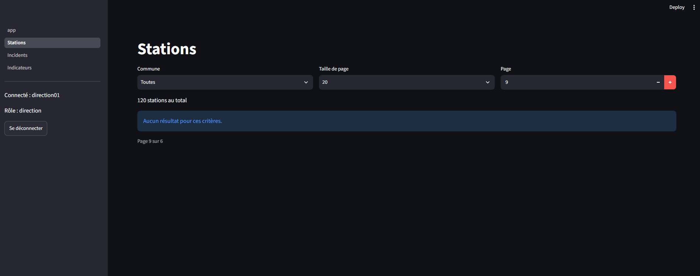
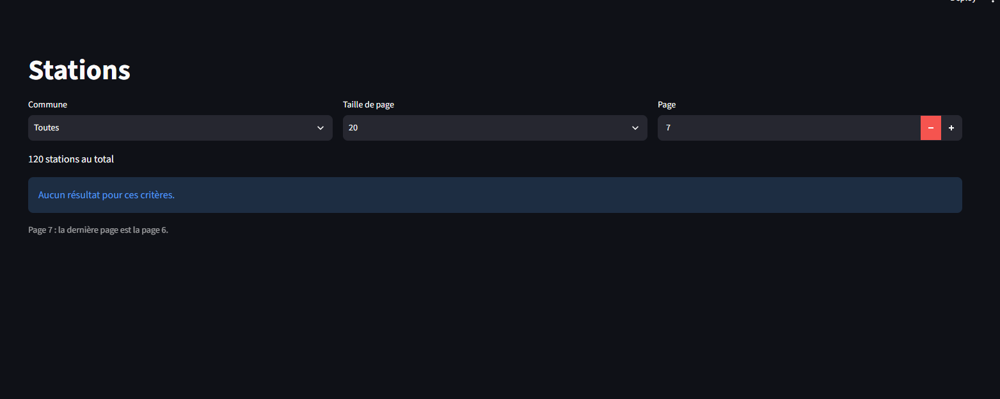

# ANO-004 - Au-delà de la dernière page, l'écran affiche « Page 9 sur 6 »

Cas de test : REC-10 (remarque)   Statut : corrigée
Sévérité : S3                 Priorité : P3
Constatée le 15/10/2026 par Meryem ATTARI

## Environnement

Version `v0.9.0`, base rechargée, compte `direction01`, front Streamlit,
écran Stations (même comportement sur l'écran Incidents).

## Reproduction

1. Se connecter au front avec `direction01`.
2. Écran Stations, taille de page 20, page 9 (il n'y a que 6 pages).
3. Lire le texte sous le message « Aucun résultat pour ces critères. ».

## Attendu / obtenu

Attendu : un texte compréhensible qui indique que la page demandée est
au-delà de la dernière.

Obtenu : « Page 9 sur 6 », ce qui n'a pas de sens pour l'utilisateur. Le
message « Aucun résultat pour ces critères. » est bien affiché, les
données ne sont pas en cause.

## Preuve

Capture prise pendant REC-10 :

## Correction

Le texte sous les tableaux paginés est produit par la fonction
`page_label` (`front/session.py`), utilisée par les écrans Stations et
Incidents. Au-delà de la dernière page, elle affiche « Page N : la dernière
page est la page M. ». On peut toujours demander une page au-delà de la
dernière : le scénario de REC-10 reste jouable.

Commit : `d8df546`  Test de non-régression :
`tests/unit/test_session.py::test_texte_de_la_page`
Rejoué le 15/10/2026 : OK (page 7 sur 6 pages)

