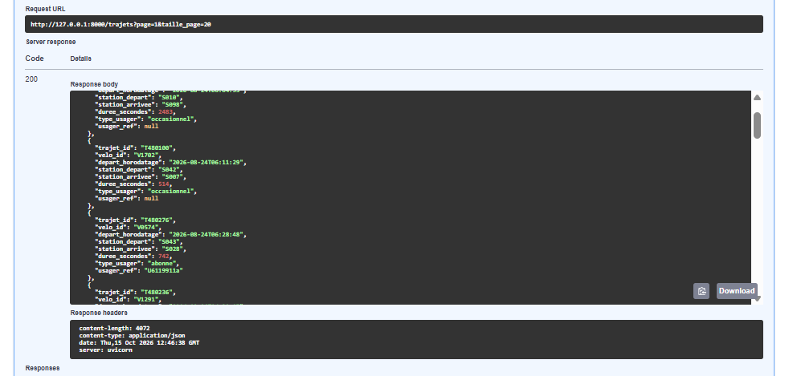
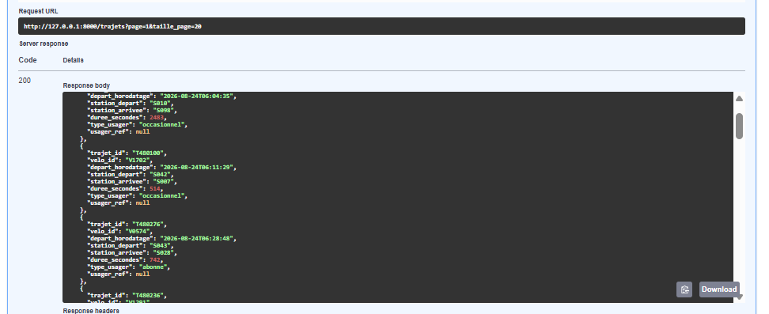

# ANO-005 - L'API renvoie le pseudonyme des abonnés au rôle direction

Cas de test : vérification complémentaire (cahier des charges 7.3, RGPD)
Statut : corrigée
Sévérité : S2                 Priorité : P1
Constatée le 15/10/2026 par Meryem ATTARI

## Environnement

Version `1766888` (branche `main`, après la recette), base rechargée,
compte `direction01`, page `/docs` de l'API, route `GET /trajets`.
Relevée lors de la rédaction du procès-verbal (réserve non bloquante).

## Reproduction

1. Se connecter dans `/docs` avec un jeton du rôle direction.
2. Appeler `GET /trajets?page=1&taille_page=20`.
3. Lire le troisième trajet, T480276, qui est un trajet d'abonné.

## Attendu / obtenu

Attendu : le cahier des charges (7.3) prévoit que `usager_ref` (pseudonyme
de l'abonné) ne soit pas montré à la direction ; il peut l'être pour
l'exploitant, à des fins de support.

Obtenu : la réponse donnée au rôle direction contient
`"usager_ref": "U6119911a"` pour le trajet T480276. Aucun écran du front
n'affiche les trajets, mais l'API, elle, ne masque pas cette donnée.

## Preuve

## Correction

La règle est dans le service `hide_usager_ref` (`api/services/trajets.py`) :
pour le rôle direction, `usager_ref` est vide (`null`) dans la réponse de
`GET /trajets`. Le routeur l'applique sur une copie des trajets : la base
n'est pas modifiée. L'exploitant voit toujours le pseudonyme.

Commit : `6c86dfc`  Test de non-régression :
`tests/integration/test_api.py::test_usager_ref_masque_pour_la_direction`
(et `test_usager_ref_visible_pour_l_exploitant`)
Rejoué le 15/10/2026 : OK

