# Résultats de recette - VéloVille

Plan déroulé : [plan-de-recette.md](plan-de-recette.md), cas REC-01 à
REC-10, dans l'ordre.

## Conditions d'exécution

- Version testée : `v0.9.0`
- Date de la campagne : 15/10/2026
- Poste : Windows 11, Python 3.14, PostgreSQL 18
- Base `veloville` recréée avec `sql/schema.sql` et `sql/comptes.sql` avant
  le premier cas
- Commandes lancées dans Git Bash ; appels HTTP faits avec le client
  interactif de FastAPI (`/docs`)

## Relevé d'exécution

| Cas | Date et heure | Version testée | Statut | Preuve | Anomalie |
|---|---|---|---|---|---|
| REC-01 | 15/10/2026 09:30 | v0.9.0 | OK | voir REC-01 | |
| REC-02 | 15/10/2026 09:46 | v0.9.0 | KO | voir REC-02 | ANO-001 |
| REC-02 (rejeu) | 15/10/2026 13:38 | 375762c | OK | voir REC-02, rejeu | ANO-001 corrigée |
| REC-03 | 15/10/2026 09:56 | v0.9.0 | OK | voir REC-03 | |
| REC-04 | 15/10/2026 10:10 | v0.9.0 | OK | voir REC-04 | |
| REC-05 | 15/10/2026 10:17 | v0.9.0 | OK | voir REC-05 | |
| REC-06 | 15/10/2026 10:30 | v0.9.0 | OK | voir REC-06 | |
| REC-07 | 15/10/2026 11:26 | v0.9.0 | OK | voir REC-07 | |
| REC-08 | 15/10/2026 11:42 | v0.9.0 | OK | voir REC-08 | |
| REC-09 | 15/10/2026 11:55 | v0.9.0 | OK | voir REC-09 | |
| REC-10 | 15/10/2026 11:03 | v0.9.0 | OK | voir REC-10 | |

## Détail des cas

### REC-01 - Import idempotent

Résultat obtenu : les deux exécutions de l'import se terminent sans
erreur. Les comptages sont identiques après la première et après la
seconde exécution : 120 stations, 2 002 trajets, 177 incidents.

Statut : OK

Preuve :

**1. Base vide, comptes chargés** (dernière ligne de la sortie)

```bash
psql -h localhost -U veloville -d veloville -f sql/schema.sql
psql -h localhost -U veloville -d veloville -f sql/comptes.sql
```

```text
INSERT 0 2
```

**2. Premier import**

```bash
python scripts/importer.py
```

```text
stations.csv : 120 lignes = 120 importées + 0 rejetées + 0 doublons écartés
trajets.csv : 2030 lignes = 2002 importées + 16 rejetées + 12 doublons écartés
incidents.csv : 180 lignes = 177 importées + 3 rejetées + 0 doublons écartés
Journal : docs\journal-import.csv (190 lignes)
```

**3. Comptages après le premier import**

```bash
psql -h localhost -U veloville -d veloville -c "SELECT count(*) FROM station;"
psql -h localhost -U veloville -d veloville -c "SELECT count(*) FROM trajet;"
psql -h localhost -U veloville -d veloville -c "SELECT count(*) FROM incident;"
```

```text
 count
-------
   120

 count
-------
  2002

 count
-------
   177
```

**4. Second import**

```bash
python scripts/importer.py
```

```text
stations.csv : 120 lignes = 120 importées + 0 rejetées + 0 doublons écartés
trajets.csv : 2030 lignes = 2002 importées + 16 rejetées + 12 doublons écartés
incidents.csv : 180 lignes = 177 importées + 3 rejetées + 0 doublons écartés
Journal : docs\journal-import.csv (190 lignes)
```

**5. Comptages après le second import**

```bash
psql -h localhost -U veloville -d veloville -c "SELECT count(*) FROM station;"
psql -h localhost -U veloville -d veloville -c "SELECT count(*) FROM trajet;"
psql -h localhost -U veloville -d veloville -c "SELECT count(*) FROM incident;"
```

```text
 count
-------
   120

 count
-------
  2002

 count
-------
   177
```

### REC-02 - Rejets journalisés et cohérence des volumes

Résultat obtenu :

- Volumes cohérents pour les trois fichiers (importées + rejetées +
  doublons écartés = lignes du CSV) :

  | Fichier | Lignes CSV | Importées | Rejetées | Doublons écartés | Total |
  |---|---|---|---|---|---|
  | stations.csv | 120 | 120 | 0 | 0 | 120 |
  | trajets.csv | 2 030 | 2 002 | 16 | 12 | 2 030 |
  | incidents.csv | 180 | 177 | 3 | 0 | 180 |

- La requête de l'étape 4 renvoie 0.
- **37 lignes du journal sur 190 ne portent pas les six informations** :
  les 12 lignes « doublon écarté » n'ont ni colonne ni valeur, et les 25
  lignes « technicien absent » n'ont pas de valeur.

Statut : KO (anomalie [ANO-001](anomalies/ANO-001.md))

Preuve :

**1. Lignes de chaque CSV** (`wc -l` compte aussi la ligne d'en-tête :
120, 2 030 et 180 lignes de données)

```bash
wc -l data/stations.csv data/trajets.csv data/incidents.csv
```

```text
   121 data/stations.csv
  2031 data/trajets.csv
   181 data/incidents.csv
```

**2. Doublons écartés, puis rejets des trajets et des incidents**

```bash
grep -c "doublon écarté" docs/journal-import.csv
grep "^trajets.csv" docs/journal-import.csv | grep -c ",rejet"
grep "^incidents.csv" docs/journal-import.csv | grep -c ",rejet"
```

```text
12
16
3
```

**3. Lignes du journal avec une case vide** (deux virgules qui se suivent)

```bash
grep -c ",," docs/journal-import.csv
```

```text
37
```

**4. Exemples de lignes incomplètes**

```bash
grep "doublon écarté" docs/journal-import.csv | head -2
grep "Technicien absent" docs/journal-import.csv | head -2
```

```text
trajets.csv,T480073,,,Ligne strictement identique à une ligne précédente,doublon écarté
trajets.csv,T480078,,,Ligne strictement identique à une ligne précédente,doublon écarté
incidents.csv,I2026-0011,technicien,,Technicien absent alors que l'incident est pris en charge (RG8),normalisation
incidents.csv,I2026-0018,technicien,,Technicien absent alors que l'incident est pris en charge (RG8),normalisation
```

**5. Aucune arrivée vers une station absente** (requête du plan)

```bash
psql -h localhost -U veloville -d veloville -c "SELECT count(*) FROM trajet t LEFT JOIN station s ON s.station_id = t.station_arrivee WHERE t.station_arrivee IS NOT NULL AND s.station_id IS NULL;"
```

```text
 count
-------
     0
```

#### Rejeu après correction de ANO-001

Rejoué le 15/10/2026 sur le commit `375762c` (branche `fix/ano-001`), après
un nouvel import.

Résultat obtenu : volumes et requête de l'étape 4 inchangés ; plus aucune
case vide dans le journal (0 ligne au lieu de 37). Les doublons portent la
colonne d'identifiant et sa valeur, les valeurs absentes sont écrites
« (vide) ».

Statut : OK

**1. Nouvel import**

```bash
python scripts/importer.py
```

```text
stations.csv : 120 lignes = 120 importées + 0 rejetées + 0 doublons écartés
trajets.csv : 2030 lignes = 2002 importées + 16 rejetées + 12 doublons écartés
incidents.csv : 180 lignes = 177 importées + 3 rejetées + 0 doublons écartés
Journal : docs\journal-import.csv (190 lignes)
```

**2. Volumes**

```bash
wc -l data/stations.csv data/trajets.csv data/incidents.csv
grep -c "doublon écarté" docs/journal-import.csv
grep "^trajets.csv" docs/journal-import.csv | grep -c ",rejet"
grep "^incidents.csv" docs/journal-import.csv | grep -c ",rejet"
```

```text
   121 data/stations.csv
  2031 data/trajets.csv
   181 data/incidents.csv
12
16
3
```

**3. Lignes du journal avec une case vide**

```bash
grep -c ",," docs/journal-import.csv
grep "doublon écarté" docs/journal-import.csv | head -2
grep "Technicien absent" docs/journal-import.csv | head -2
```

```text
0
trajets.csv,T480073,trajet_id,T480073,Ligne strictement identique à une ligne précédente,doublon écarté
trajets.csv,T480078,trajet_id,T480078,Ligne strictement identique à une ligne précédente,doublon écarté
incidents.csv,I2026-0011,technicien,(vide),Technicien absent alors que l'incident est pris en charge (RG8),normalisation
incidents.csv,I2026-0018,technicien,(vide),Technicien absent alors que l'incident est pris en charge (RG8),normalisation
```

**4. Aucune arrivée vers une station absente**

```bash
psql -h localhost -U veloville -d veloville -c "SELECT count(*) FROM trajet t LEFT JOIN station s ON s.station_id = t.station_arrivee WHERE t.station_arrivee IS NOT NULL AND s.station_id IS NULL;"
```

```text
 count
-------
     0
```

### REC-03 - Connexion acceptée

Résultat obtenu : les deux connexions répondent 200, avec un
`access_token` non vide, `token_type` = `bearer` et le bon rôle
(`exploitant` pour `exploitant01`, `direction` pour `direction01`).

Statut : OK

Preuve : appels faits avec le client interactif `/docs` (jetons raccourcis
ici et masqués sur les captures).

**1. Connexion avec `exploitant01`**

```http
POST /auth/login
{"username": "exploitant01", "password": "Formation2026!"}
```

```text
Code : 200
{
  "access_token": "eyJhbGci...",
  "token_type": "bearer",
  "role": "exploitant"
}
```

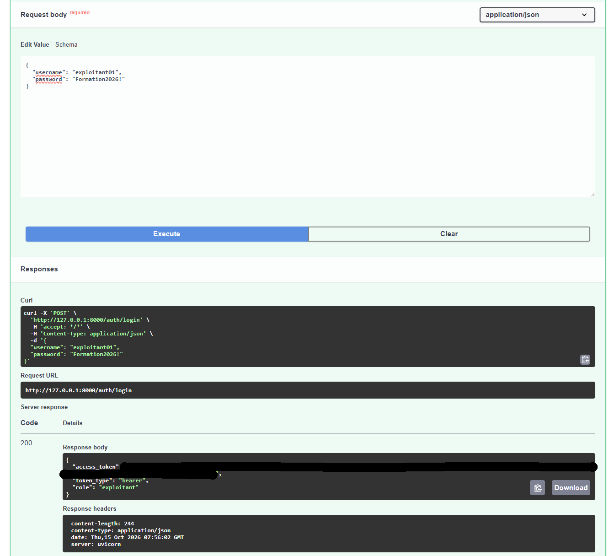

**2. Connexion avec `direction01`**

```http
POST /auth/login
{"username": "direction01", "password": "Formation2026!"}
```

```text
Code : 200
{
  "access_token": "eyJhbGci...",
  "token_type": "bearer",
  "role": "direction"
}
```


### REC-04 - Connexion refusée

Résultat obtenu : les deux tentatives sont refusées avec le code 401 et
le même corps `{"detail": "Identifiants invalides"}` : le message ne révèle
pas si l'identifiant existe.

Statut : OK

Preuve : requêtes envoyées depuis la page `/docs` de l'API.

**1. Bon identifiant, mauvais mot de passe**

```http
POST /auth/login
{"username": "exploitant01", "password": "mauvais"}
```

```text
Code : 401
{
  "detail": "Identifiants invalides"
}
```

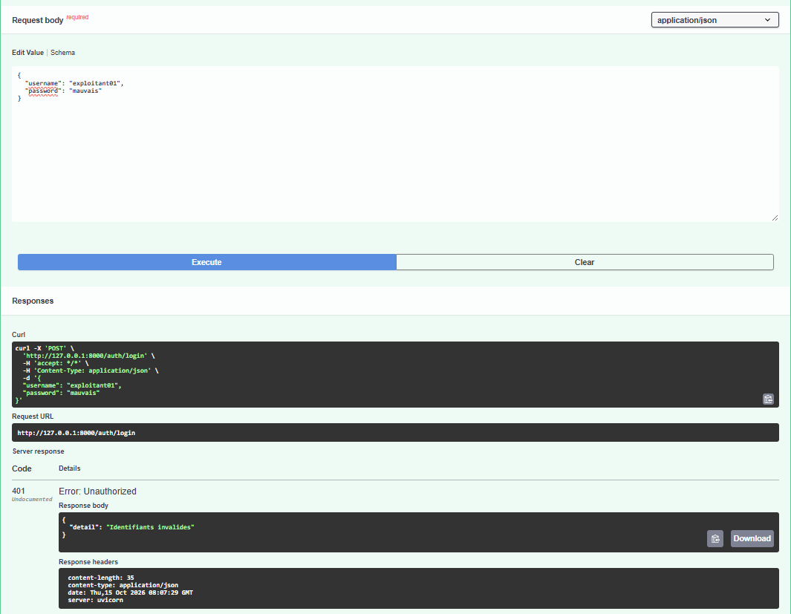

**2. Identifiant inconnu**

```http
POST /auth/login
{"username": "inconnu", "password": "Formation2026!"}
```

```text
Code : 401
{
  "detail": "Identifiants invalides"
}
```

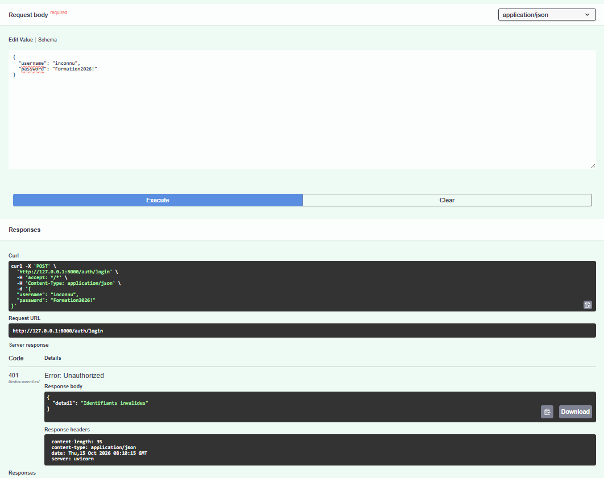

### REC-05 - Route protégée sans jeton

Résultat obtenu : `GET /stations` est refusé sans jeton (401
« Authentification requise ») et avec un faux jeton (401 « Jeton
invalide ») ; `GET /sante` répond sans jeton (200 `{"statut": "ok"}`).

Statut : OK

Preuve : requêtes envoyées depuis la page `/docs` de l'API.

**1. `GET /stations` sans en-tête `Authorization`**

```http
GET /stations?page=1&taille_page=20
```

```text
Code : 401
{
  "detail": "Authentification requise"
}
```


**2. `GET /stations` avec un faux jeton**

```http
GET /stations?page=1&taille_page=20
Authorization: Bearer jeton.invalide.xyz
```

```text
Code : 401
{
  "detail": "Jeton invalide"
}
```

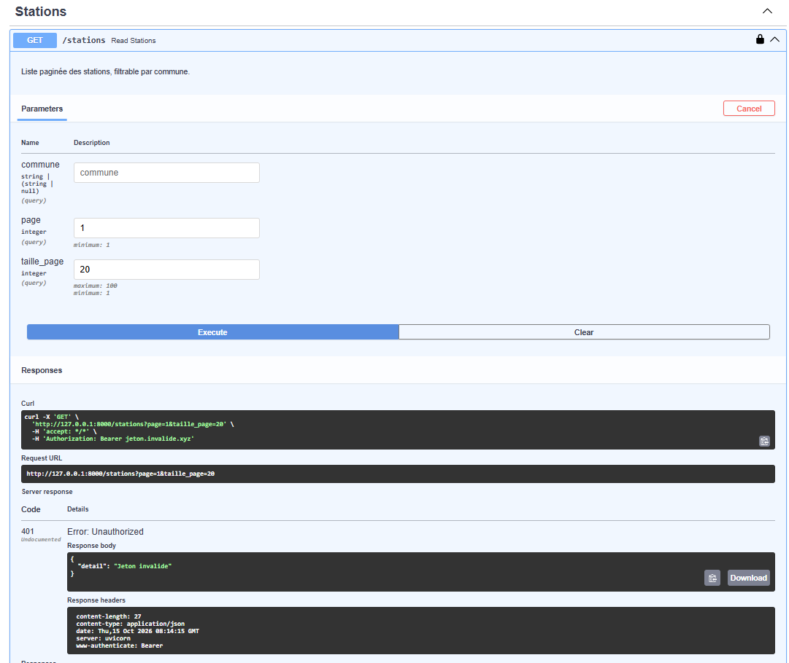

**3. `GET /sante` sans en-tête `Authorization`**

```http
GET /sante
```

```text
Code : 200
{
  "statut": "ok"
}
```

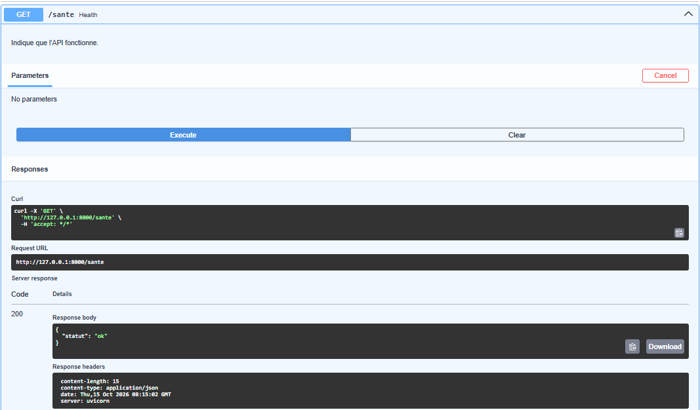

### REC-06 - Rôle direction refusé sur la modification d'un incident

Résultat obtenu : incident utilisé `I2026-0002`, au statut `ouvert`.
Le rôle direction reçoit 403 et le statut reste `ouvert` en base ; le rôle
exploitant obtient 200 et le statut passe à `en_cours` en base ; une
seconde demande `en_cours` est refusée avec 422.

Statut : OK

Preuve : requêtes envoyées depuis la page `/docs` (jetons barrés sur les
captures), vérifications en base dans Git Bash.

**1. `PUT` avec le jeton direction**

```http
PUT /incidents/I2026-0002/statut
Authorization: Bearer <jeton direction>
{"statut": "en_cours"}
```

```text
Code : 403
{
  "detail": "Acces reserve au role exploitant"
}
```

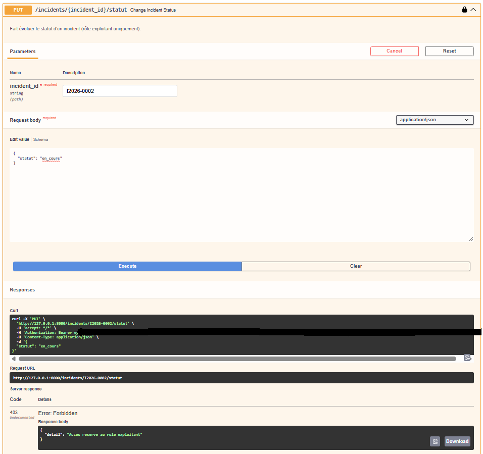

**2. Statut en base après le refus**

```bash
psql -h localhost -U veloville -d veloville -c "SELECT statut FROM incident WHERE incident_id = 'I2026-0002';"
```

```text
 statut
--------
 ouvert
```

**3. `PUT` avec le jeton exploitant**

```http
PUT /incidents/I2026-0002/statut
Authorization: Bearer <jeton exploitant>
{"statut": "en_cours"}
```

```text
Code : 200
{
  "incident_id": "I2026-0002",
  "date_signalement": "2026-08-26T20:00:00",
  "cible": "station",
  "velo_id": null,
  "station_id": "S075",
  "type_incident": "selle abimee",
  "statut": "en_cours",
  "date_resolution": null,
  "technicien": null
}
```

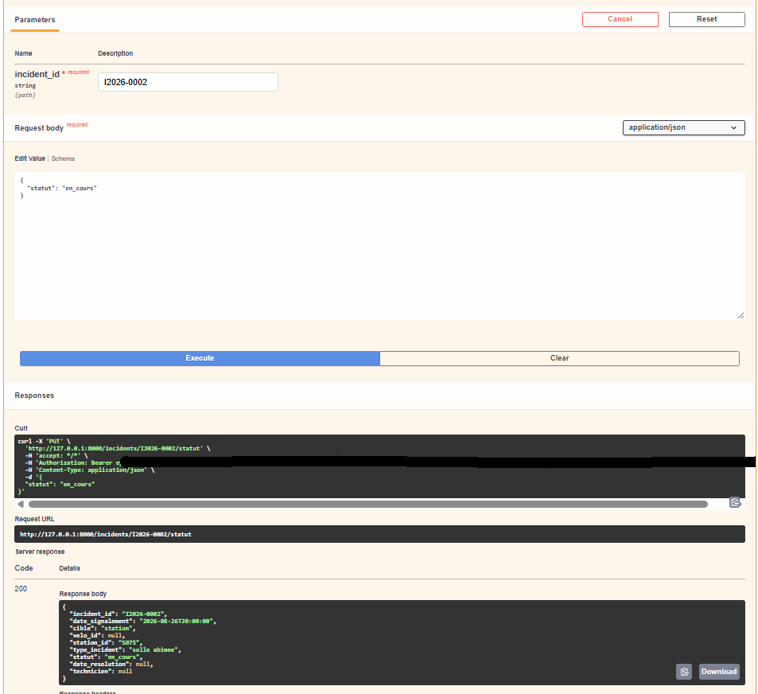

**4. Statut en base après la modification**

```bash
psql -h localhost -U veloville -d veloville -c "SELECT statut FROM incident WHERE incident_id = 'I2026-0002';"
```

```text
  statut
----------
 en_cours
```

**5. Seconde demande `en_cours` avec le jeton exploitant**

```http
PUT /incidents/I2026-0002/statut
Authorization: Bearer <jeton exploitant>
{"statut": "en_cours"}
```

```text
Code : 422
{
  "detail": "Transition de statut non autorisee"
}
```

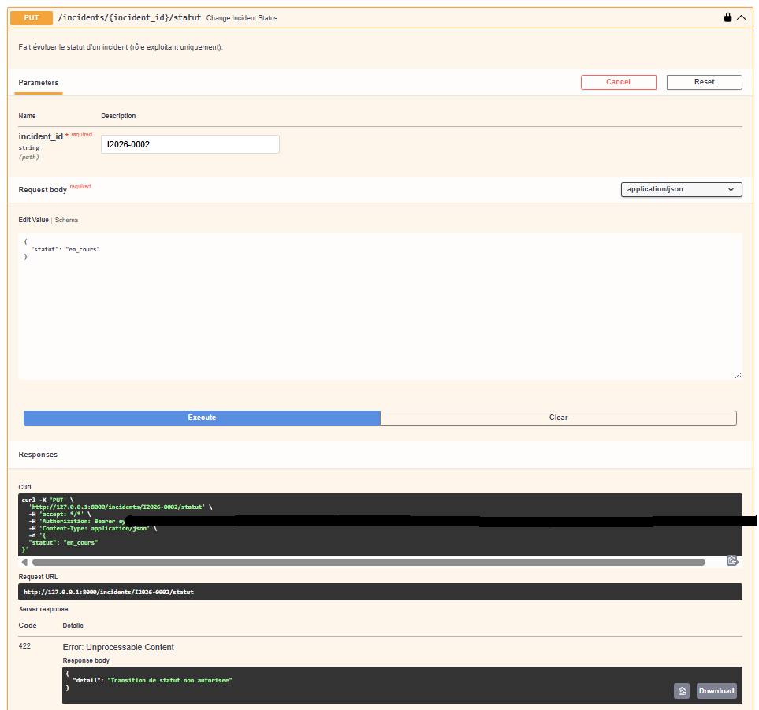

### REC-07 - Pagination

Résultat obtenu : les cinq étapes donnent le résultat attendu. Les
stations étant triées par identifiant et numérotées sans trou, le nombre de
résultats se lit avec le premier et le dernier `station_id` de la liste.

| Étape | Requête | Résultat |
|---|---|---|
| 1 | `taille_page=50&page=1` | 200, total 120, page 1, taille 50, de S001 à S050 (50 résultats) |
| 2 | `taille_page=50&page=3` | 200, de S101 à S120 (20 résultats) |
| 3 | `commune=Lille&taille_page=100` | 200, total 46, de S001 à S046, toutes à Lille |
| 4 | `page=0` | 422 |
| 5 | `taille_page=101` | 422 |

Statut : OK

Preuve : étapes 1 à 3 depuis la page `/docs` avec le jeton direction ;
étapes 4 et 5 avec `curl` dans Git Bash, car `/docs` refuse d'envoyer des
valeurs hors bornes.

**1. `GET /stations?page=1&taille_page=50`**

```text
Code : 200
{"total": 120, "page": 1, "taille_page": 50, "resultats": [
  {"station_id": "S001", ...}, ... , {"station_id": "S050", ...}]}
```

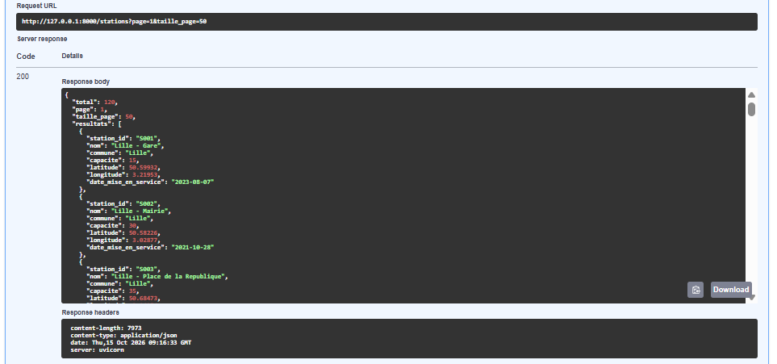

**2. `GET /stations?page=3&taille_page=50`**

```text
Code : 200
{"total": 120, "page": 3, "taille_page": 50, "resultats": [
  {"station_id": "S101", ...}, ... , {"station_id": "S120", ...}]}
```

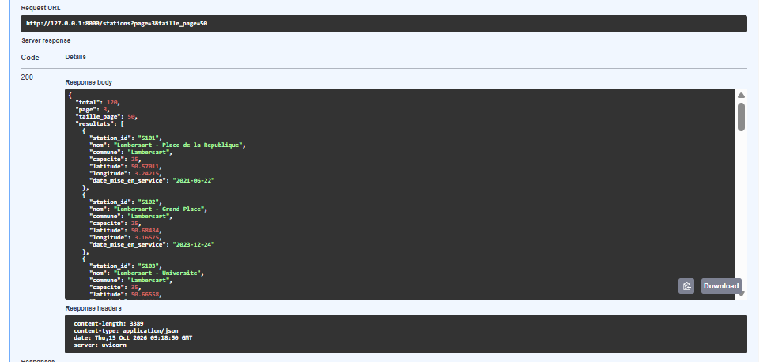

**3. `GET /stations?commune=Lille&page=1&taille_page=100`**

```text
Code : 200
{"total": 46, "page": 1, "taille_page": 100, "resultats": [
  {"station_id": "S001", "commune": "Lille", ...}, ... ,
  {"station_id": "S046", "commune": "Lille", ...}]}
```

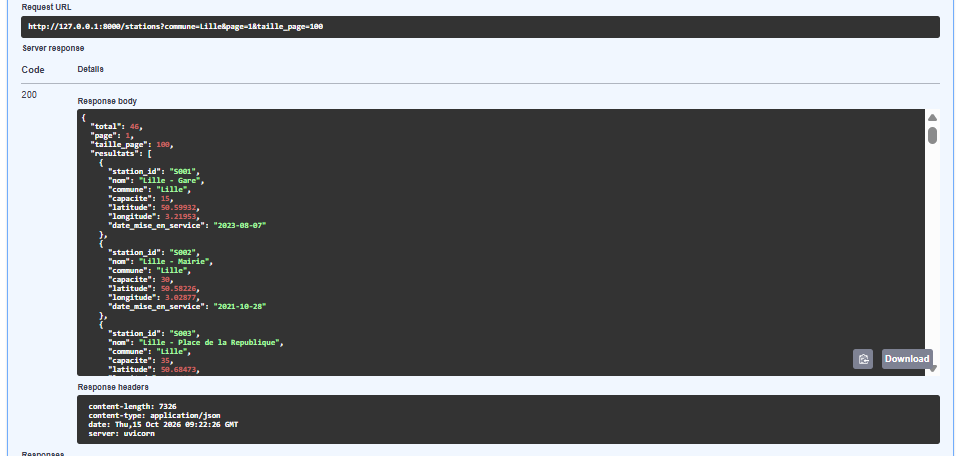

**4. `page=0`**

```bash
curl -s -w "\nCode : %{http_code}\n" -H "Authorization: Bearer $JETON_DIRECTION" "http://localhost:8000/stations?page=0"
```

```text
{"detail":[{"type":"greater_than_equal","loc":["query","page"],"msg":"Input should be greater than or equal to 1","input":"0","ctx":{"ge":1}}]}
Code : 422
```

**5. `taille_page=101`**

```bash
curl -s -w "\nCode : %{http_code}\n" -H "Authorization: Bearer $JETON_DIRECTION" "http://localhost:8000/stations?taille_page=101"
```

```text
{"detail":[{"type":"less_than_equal","loc":["query","taille_page"],"msg":"Input should be less than or equal to 100","input":"101","ctx":{"le":100}}]}
Code : 422
```

### REC-08 - Station introuvable

Résultat obtenu : `S001` renvoie 200 avec `nom` = `Lille - Gare` ;
`S999` renvoie 404 `{"detail": "Station introuvable"}`.

Statut : OK

Preuve : requêtes envoyées depuis la page `/docs` avec le jeton direction.

**1. `GET /stations/S001`**

```text
Code : 200
{
  "station_id": "S001",
  "nom": "Lille - Gare",
  "commune": "Lille",
  "capacite": 15,
  "latitude": 50.59932,
  "longitude": 3.21953,
  "date_mise_en_service": "2023-08-07"
}
```

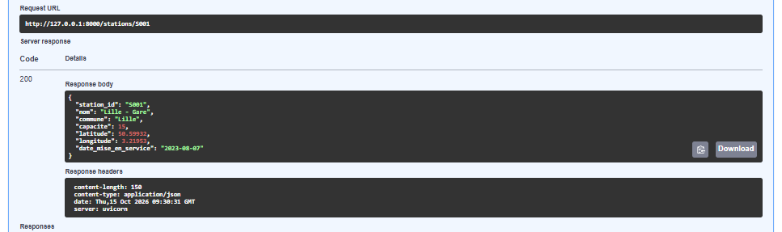

**2. `GET /stations/S999`**

```text
Code : 404
{
  "detail": "Station introuvable"
}
```

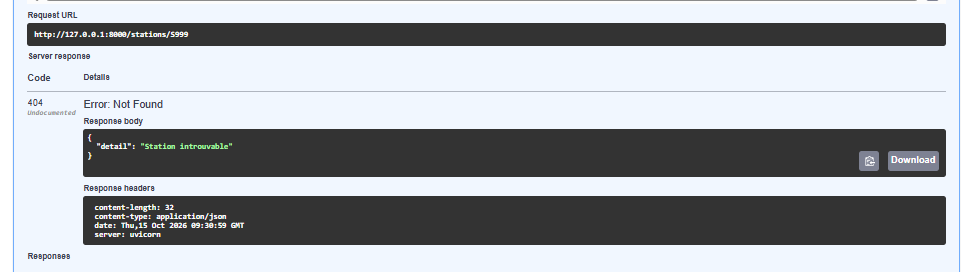

### REC-09 - Cohérence de l'indicateur « activité par jour » avec la base

Résultat obtenu : les 7 lignes de l'API et de la requête SQL sont
identiques (mêmes jours, mêmes comptages, ordre croissant). La somme des
`nb_trajets` vaut 329 + 311 + 306 + 300 + 315 + 219 + 222 = 2 002, égale au
`total` renvoyé par `GET /trajets` sur la même période.

| Jour | API | SQL |
|---|---|---|
| 2026-08-24 | 329 | 329 |
| 2026-08-25 | 311 | 311 |
| 2026-08-26 | 306 | 306 |
| 2026-08-27 | 300 | 300 |
| 2026-08-28 | 315 | 315 |
| 2026-08-29 | 219 | 219 |
| 2026-08-30 | 222 | 222 |
| **Total** | **2 002** | **2 002** |

Statut : OK

Preuve : appels API depuis la page `/docs` avec le jeton direction,
requête SQL dans Git Bash (`-P pager=off` affiche le résultat d'un seul
bloc, la requête est celle du plan).

**1. `GET /indicateurs/activite-par-jour?date_debut=2026-08-24&date_fin=2026-08-30`**

```text
Code : 200
{"donnees": [
  {"jour": "2026-08-24", "nb_trajets": 329},
  {"jour": "2026-08-25", "nb_trajets": 311},
  {"jour": "2026-08-26", "nb_trajets": 306},
  {"jour": "2026-08-27", "nb_trajets": 300},
  {"jour": "2026-08-28", "nb_trajets": 315},
  {"jour": "2026-08-29", "nb_trajets": 219},
  {"jour": "2026-08-30", "nb_trajets": 222}
]}
```

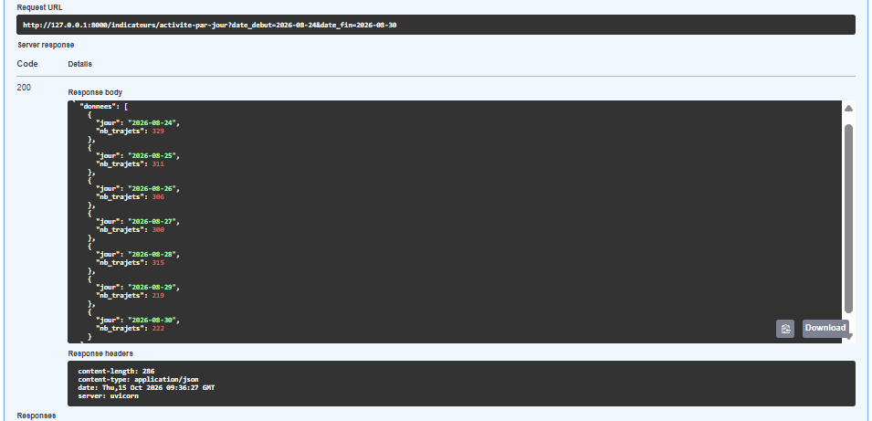

**2. Requête SQL de contrôle**

```bash
psql -P pager=off -h localhost -U veloville -d veloville -c "SELECT depart_horodatage::date AS jour, count(*) AS nb_trajets FROM trajet WHERE depart_horodatage::date BETWEEN '2026-08-24' AND '2026-08-30' GROUP BY jour ORDER BY jour;"
```

```text
    jour    | nb_trajets
------------+------------
 2026-08-24 |        329
 2026-08-25 |        311
 2026-08-26 |        306
 2026-08-27 |        300
 2026-08-28 |        315
 2026-08-29 |        219
 2026-08-30 |        222
(7 rows)
```

**3. `GET /trajets?date_debut=2026-08-24&date_fin=2026-08-30`**

```text
Code : 200
{"total": 2002, "page": 1, "taille_page": 20, "resultats": [...]}
```

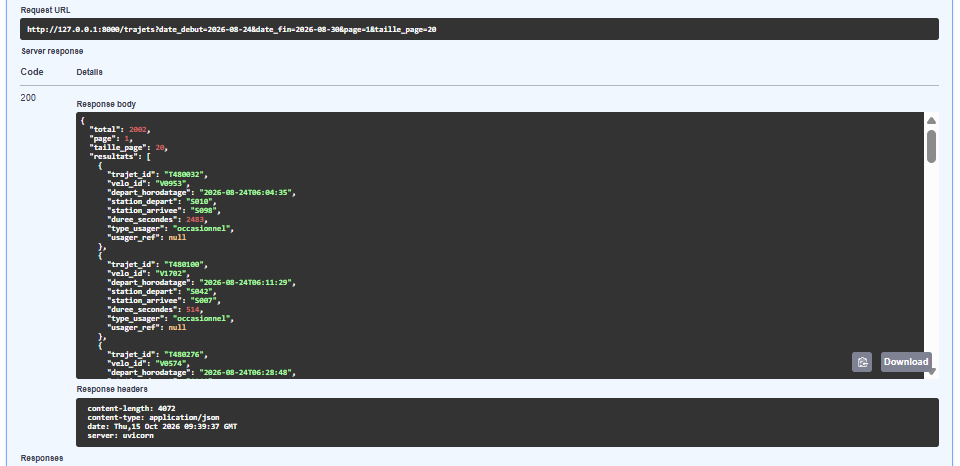

### REC-10 - Front : état vide et état d'erreur

Résultat obtenu : connecté avec `direction01`. L'état vide affiche
« Aucun résultat pour ces critères. ». API arrêtée, les écrans Stations et
Indicateurs affichent « L'API est injoignable. Vérifiez qu'elle est
démarrée. », sans trace Python. API redémarrée, le tableau des stations
s'affiche de nouveau.

Les trois statuts d'incident ont tous des incidents dans les données : le
filtre de l'écran Incidents ne donne jamais une liste vide. L'état vide a
donc été vérifié avec l'alternative prévue par le plan (écran Stations,
page au-delà de la dernière).

Remarque : l'écran affiche alors « Page 9 sur 6 ». Ce n'est pas une
exigence du cas, mais le champ « Page » pourrait être limité au nombre de
pages existantes (voir axes d'amélioration).

Statut : OK

Preuve : captures du front Streamlit. Chaque écran a été rechargé en
cliquant sur son nom dans la barre latérale (et non avec F5, qui
efface la session et donc la connexion).

**1. État vide : Stations, taille de page 20, page 9**


**2 et 3. API arrêtée (Ctrl+C), écran Stations**

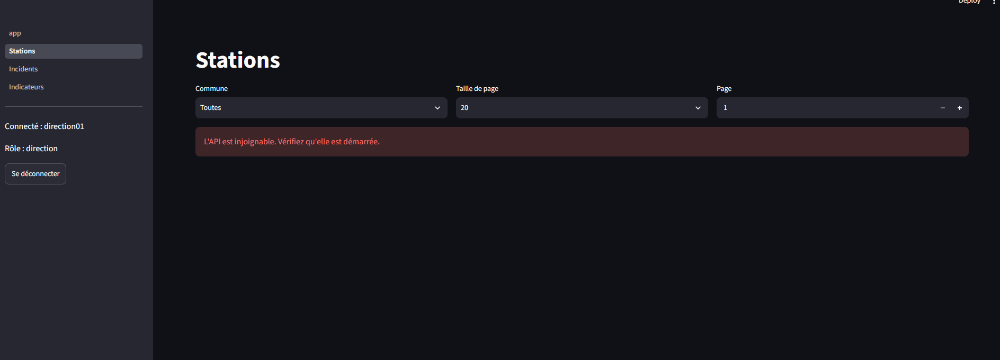

**4. API arrêtée, écran Indicateurs**

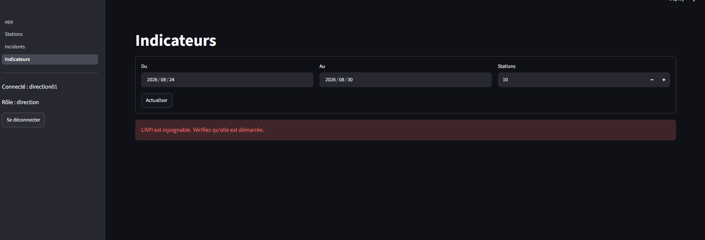

Vérification supplémentaire : l'écran Incidents affiche le même message.

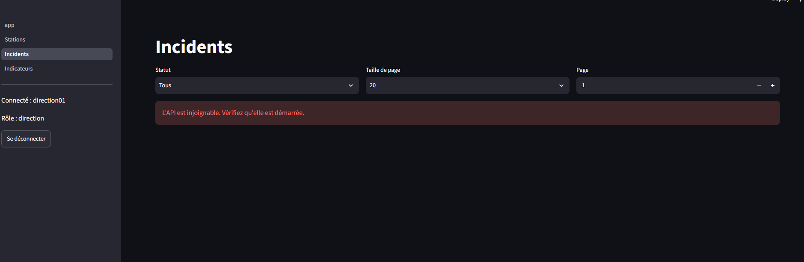

**5. API redémarrée, écran Stations**

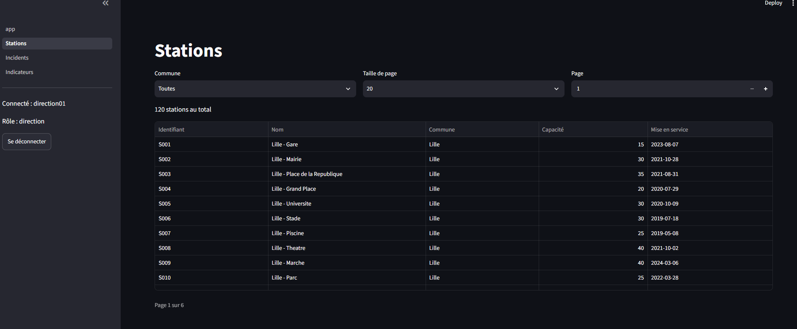

## Vérification complémentaire : temps de réponse (exigence 7.1)

Hors plan de recette. Le cahier des charges demande que toute consultation
paginée réponde en moins de 2 secondes sur le jeu V1.

Date : 15/10/2026 ; version : `0646a95`.

Résultat obtenu : l'API répond en quelques millisecondes, mais chaque
écran du front met environ 4 secondes à s'afficher. Chaque appel du front
à l'API, à l'adresse `http://localhost:8000`, prend environ 2 secondes ;
le même appel à `http://127.0.0.1:8000` est immédiat.

Statut : KO (anomalie [ANO-002](anomalies/ANO-002.md))

Preuve :

```bash
python -c "import time, requests; t = time.time(); requests.get('http://localhost:8000/sante'); print(round(time.time() - t, 2), 'secondes')"
python -c "import time, requests; t = time.time(); requests.get('http://127.0.0.1:8000/sante'); print(round(time.time() - t, 2), 'secondes')"
grep "^API_URL" .env
```

```text
2.05 secondes
0.0 secondes
API_URL=http://localhost:8000
```

### Rejeu après correction de ANO-002

Rejoué le 15/10/2026 14:02 sur le commit `90dbe51` (branche `fix/ano-002`),
avec `API_URL=http://127.0.0.1:8000` dans `.env` et le front redémarré.

Résultat obtenu : l'adresse configurée pour le front est `127.0.0.1` et un
appel à l'API répond en 0,02 seconde. Dans le front, connecté avec
`direction01`, les écrans Stations, Incidents et Indicateurs s'affichent
rapidement à chaque clic (constat de l'utilisatrice, au lieu d'environ 4
secondes avant correction).

Statut : OK

```bash
grep "^API_URL" .env
python -c "import time, requests; t = time.time(); requests.get('http://127.0.0.1:8000/sante'); print(round(time.time() - t, 2), 'secondes')"
```

```text
API_URL=http://127.0.0.1:8000
0.02 secondes
```

## Vérification complémentaire : adresse d'API mal écrite

Hors plan de recette. Constatée pendant le rejeu de ANO-002, après une
erreur de saisie dans la ligne `API_URL` du fichier `.env`.

Date : 15/10/2026 ; version : `55ac61c`.

Résultat obtenu : au lieu d'un message d'erreur en français, l'écran de
connexion affiche la trace Python complète (`requests.exceptions.InvalidSchema`).

Statut : KO (anomalie [ANO-003](anomalies/ANO-003.md))

Preuve :

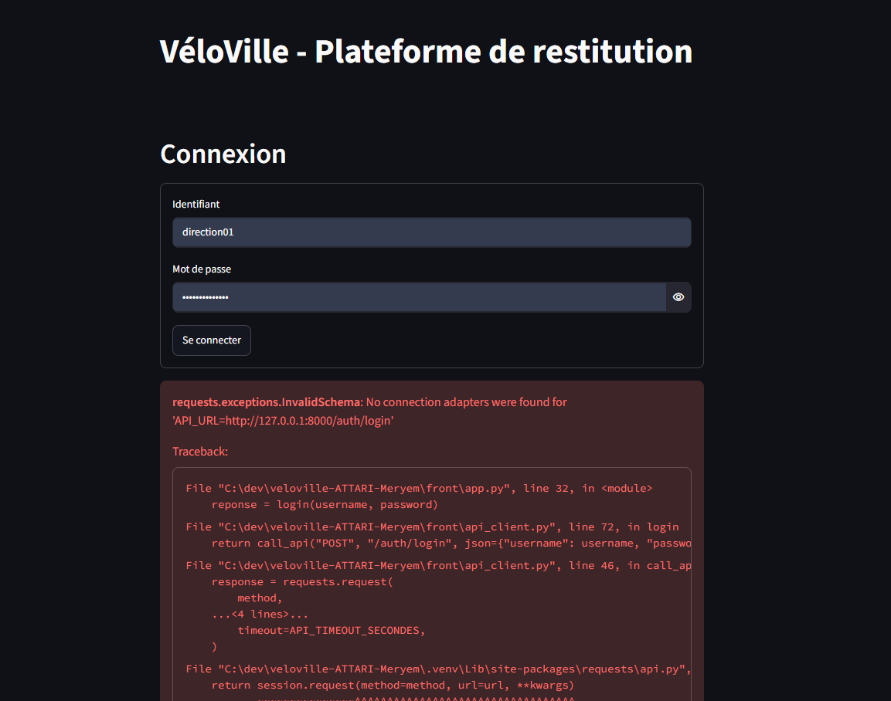

### Rejeu après correction de ANO-003

Rejoué le 15/10/2026 14:19 sur le commit `5bfbc93` (branche `fix/ano-003`),
avec la même adresse mal écrite.

Résultat obtenu : l'écran de connexion affiche « Impossible de contacter
l'API. Vérifiez l'adresse API_URL dans le fichier .env. », en français et
sans trace Python.

Statut : OK

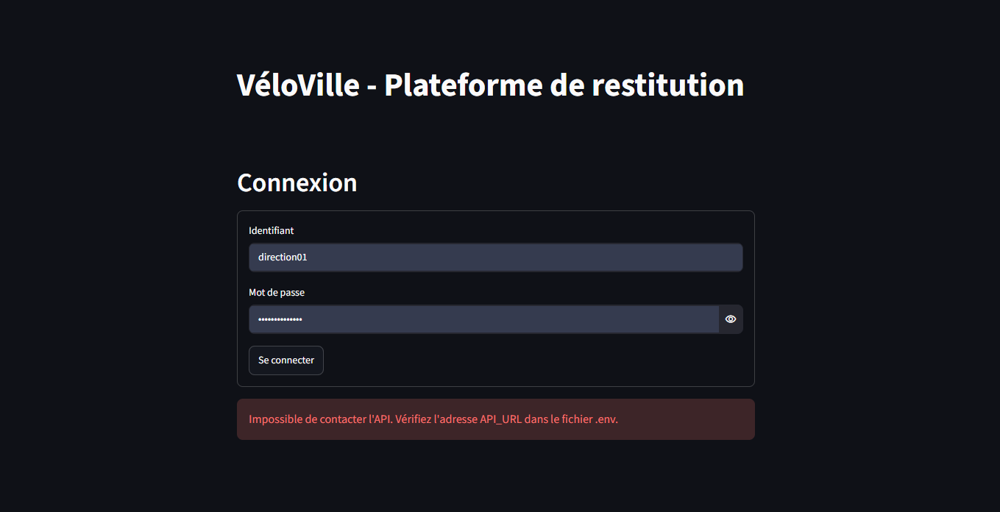

## Synthèse

À remplir après la campagne : N cas exécutés sur 10 ; N OK, N KO, N NT ;
N anomalies ouvertes, N corrigées.

## Procès-verbal de recette

À remplir à la fin de la campagne (modèle dans le plan de recette).

## Axes d'amélioration

À remplir à la fin de la campagne (au moins trois propositions argumentées).
